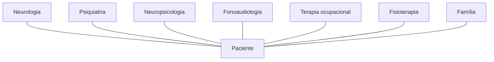

<!--
- Estrutura do encontro: 50 min de apresentação da disciplina, 1 h de panorama (neuropsicologia do adulto, ética, laudo), 30 min de intervalo, 40 min para formar os grupos e sortear os transtornos do seminário.
- **SATEPSI** — Sistema de Avaliação de Testes Psicológicos, do Conselho Federal de Psicologia.
- **CFP** — Conselho Federal de Psicologia.
-->

---
layout: agenda
kicker: Aula 01 · o caminho de hoje
title: Caminho da aula
items:
  - {
      topic: "A disciplina",
      desc: "ementa, cronograma, avaliação e combinados"
    }
  - {
      topic: "A neuropsicologia do adulto",
      desc: "o que ela pergunta, onde atua e com quem"
    }
  - {
      topic: "Da avaliação ao laudo",
      desc: "o percurso de um caso e o documento que sai dele"
    }
  - {
      topic: "Ética na prática",
      desc: "sigilo, devolutiva, instrumentos e limites"
    }
  - {
      topic: "Formação dos grupos",
      desc: "sorteio dos transtornos do seminário"
    }
---

---
layout: section
index: "01"
kicker: Parte um
title: A disciplina
subtitle: Ementa, cronograma e avaliação.
---

---
layout: define
kicker: A ementa
term: Neuropsicologia II
definition: Os processos neuropsicológicos da vida adulta e do envelhecimento, com
  ênfase em <em>avaliação</em> e <em>reabilitação</em>.
points:
  - "Síndromes: AVC, traumatismo craniano, demências, epilepsia, esclerose e quadros psiquiátricos"
  - "Funções cognitivas complexas e os instrumentos que as medem"
  - "Avaliação computadorizada e normas brasileiras"
  - "Planejamento de reabilitação, ética e trabalho interdisciplinar"
---

<!--
- Neuropsicologia I tratou do desenvolvimento. Aqui o cérebro já está formado — e o que interessa é o que acontece quando ele é lesado, adoece ou envelhece.
- O fio do semestre: entender o quadro, avaliar o que ele fez com a cognição, escrever o laudo e planejar o cuidado.
-->

---
layout: columns
kicker: Cronograma
title: Primeiro bimestre
columns:
  - {
      title: "Fundamentos",
      items: [
        "<strong>S1</strong> · Apresentação da disciplina",
        "<strong>S2</strong> · Funções cognitivas I",
        "<strong>S3</strong> · Funções cognitivas II"
      ]
    }
  - {
      title: "Quadros",
      items: [
        "<strong>S4</strong> · Acidente vascular cerebral",
        "<strong>S5</strong> · Traumatismo cranioencefálico",
        "<strong>S6</strong> · Cognição nos transtornos psiquiátricos"
      ]
    }
  - {
      title: "Avaliação",
      items: [
        "<strong>S7</strong> · Seminários I",
        "<strong>S8</strong> · Seminários II",
        "<strong>S9</strong> · Prova 1",
        "<strong>S10</strong> · Vista da prova 1"
      ]
    }
---

<!--
- Datas exatas no plano de ensino publicado no portal.
- As aulas de quadro seguem sempre o mesmo desenho: o quadro em detalhe na primeira metade e, no fim, o caso levado ao laudo.
-->

---
layout: columns
kicker: Cronograma
title: Segundo bimestre
columns:
  - {
      title: "Quadros",
      items: [
        "<strong>S11</strong> · Transtornos neurocognitivos",
        "<strong>S12</strong> · Epilepsia",
        "<strong>S13</strong> · Esclerose múltipla e ELA"
      ]
    }
  - {
      title: "Reabilitação",
      items: [
        "<strong>S14</strong> · Fundamentos",
        "<strong>S15</strong> · Técnicas",
        "<strong>S16</strong> · Avaliação, planejamento e equipe",
        "<strong>S17</strong> · Estudo de caso"
      ]
    }
  - {
      title: "Avaliação",
      items: [
        "<strong>S18</strong> · Prova 2",
        "<strong>S19</strong> · Vista da prova 2",
        "<strong>S20</strong> · Substitutiva e exame"
      ]
    }
---

---
layout: panels
kicker: Avaliação
title: Quatro momentos de nota
panels:
  - {
      icon: "lucide:presentation",
      title: "Seminário",
      body: "Em grupo, nas semanas 7 e 8. Cada grupo apresenta a neuropsicologia de
        <strong>um transtorno psiquiátrico</strong>."
    }
  - {
      icon: "lucide:file-check",
      title: "Prova 1",
      body: "Semana 9. Dez questões objetivas sobre as aulas 1 a 8."
    }
  - {
      icon: "lucide:clapperboard",
      title: "Plano de reabilitação",
      body: "Em grupo, entregue na semana 17. Um plano escrito para o protagonista
        do filme <em>Meu Pai</em>."
    }
  - {
      icon: "lucide:file-check-2",
      title: "Prova 2",
      body: "Semana 18. Dez questões objetivas sobre as aulas 11 a 17."
    }
---

<!--
- O peso de cada atividade na média segue o regimento e está no plano de ensino.
- Substitutiva e exame (S20) cobrem o semestre inteiro.
- As propostas do seminário e do trabalho do filme, com rubrica, estão publicadas junto com os slides.
-->

---
layout: feature
kicker: Combinados
title: O que se espera de cada encontro
columns: 3
features:
  - {
      icon: "lucide:book-open",
      title: "Leitura",
      desc: "a referência de cada aula está no último slide e na pasta da disciplina"
    }
  - {
      icon: "lucide:users",
      title: "Dinâmica",
      desc: "toda aula de quadro termina com um caso para resolver em grupo"
    }
  - {
      icon: "lucide:list-checks",
      title: "Banco de questões",
      desc: "cinco questões por aula, do fácil ao difícil, com gabarito"
    }
---

<!--
- O banco de questões de cada bimestre é o material de estudo para a prova. As questões da prova não são as do banco, mas cobram o mesmo núcleo.
- Slides publicados com PDF para download — a URL está no portal.
-->

---
layout: section
index: "02"
kicker: Parte dois
title: A neuropsicologia do adulto
subtitle: Cérebro, comportamento e contexto.
---

---
layout: define
kicker: A definição
term: Neuropsicologia
definition: Ciência e prática clínica que estudam a relação entre o
  <em>funcionamento cerebral</em> e o <em>comportamento</em> — cognição, emoção e
  conduta.
points:
  - "Nasce da clínica neurológica e da psicologia experimental"
  - "No Brasil, é especialidade reconhecida pelo CFP desde 2004"
  - "Atua na avaliação, na reabilitação e na pesquisa"
---

<!--
- Resolução CFP 02/2004 reconhece a especialidade.
- Ponto de partida da aula 02: o objeto da neuropsicologia não é o cérebro nem o teste — é a relação entre os dois, observada num comportamento.
-->

---
layout: timeline
kicker: De onde vem a área
title: Quatro casos que fundaram a disciplina
events:
  - { date: "1848", title: "Phineas Gage", desc: "a conduta muda e a inteligência fica" }
  - { date: "1861", title: "Leborgne", desc: "Broca localiza a produção da fala" }
  - { date: "1874", title: "Wernicke", desc: "a compreensão tem outro endereço" }
  - { date: "1953", title: "H.M.", desc: "Milner separa memória de inteligência" }
---

<!--
- O fio comum: em todos, uma lesão circunscrita tirou uma função e deixou as outras. É a lógica da **dissociação**, que sustenta a avaliação até hoje.
- Luria (1902-1977) fecha o arco: deixa de procurar um centro para cada função e passa a falar de sistemas funcionais — é o modelo que a reabilitação herda.
-->

---
layout: image
kicker: A lógica da área
title: A dissociação
image: /encefalo-leborgne.jpg
side: right
alt: Encéfalo de Leborgne, paciente de Broca, com a lesão visível no giro frontal inferior esquerdo
---

Uma lesão tira uma função e deixa outra intacta.

Quando duas lesões fazem o inverso, temos a **dupla dissociação** — e a prova de que as
duas funções são separáveis.

<!--
- Leborgne compreendia e não produzia; os pacientes de Wernicke produziam e não compreendiam. Dupla dissociação clássica.
- Na avaliação, é o mesmo raciocínio aplicado a uma pessoa: o perfil de forças e fraquezas é que aponta o sistema comprometido.
- Imagem: domínio público, Wikimedia Commons.
-->

---
layout: vs
kicker: Os dois braços da clínica
title: Avaliação e reabilitação
left:
  title: "Avaliação"
  items:
    - "Descreve o perfil cognitivo e comportamental"
    - "Compara com a norma e com a história"
    - "Sustenta diagnóstico e decisão"
    - "Produz o laudo"
right:
  title: "Reabilitação"
  items:
    - "Parte do perfil e das metas da pessoa"
    - "Restaura, compensa ou adapta"
    - "Mede o que mudou na vida diária"
    - "Produz o plano de cuidado"
label: "→"
---

<!--
- O primeiro bimestre fica quase todo na metade esquerda; o segundo atravessa para a direita.
- Uma avaliação que não serve para planejar nada é uma avaliação incompleta. É a frase que amarra o semestre.
-->

---
layout: feature
kicker: Para que se avalia
title: Seis perguntas que chegam ao neuropsicólogo
columns: 3
features:
  - {
      icon: "lucide:stethoscope",
      title: "Diagnóstico",
      desc: "há um declínio, e de que tipo?"
    }
  - {
      icon: "lucide:git-compare",
      title: "Diferencial",
      desc: "demência ou depressão, lesão ou ansiedade?"
    }
  - {
      icon: "lucide:activity",
      title: "Acompanhamento",
      desc: "o quadro piorou, estabilizou ou melhorou?"
    }
  - {
      icon: "lucide:scissors",
      title: "Pré e pós-cirúrgico",
      desc: "o que a cirurgia pode custar à cognição?"
    }
  - {
      icon: "lucide:briefcase",
      title: "Capacidade",
      desc: "pode trabalhar, dirigir, decidir sobre os bens?"
    }
  - {
      icon: "lucide:target",
      title: "Reabilitação",
      desc: "o que treinar, o que compensar, com que meta?"
    }
---

<!--
- A pergunta de encaminhamento decide o protocolo. Sem ela, a avaliação vira uma bateria aplicada por hábito.
- Exemplos do semestre: a epilepsia (aula 12) traz a pergunta pré-cirúrgica; o TCE (aula 05), a de retorno ao trabalho; os TNC (aula 11), a de diagnóstico diferencial.
-->

---
layout: diagram
kicker: Quem está na sala
title: A equipe em volta do paciente
---

<!--
- A neuropsicologia raramente decide sozinha. O laudo chega ao neurologista para compor um diagnóstico; ao fonoaudiólogo para planejar a terapia de linguagem; à família para entender o que mudou.
- **TO** — terapia ocupacional: funcionalidade e atividades de vida diária.
- Interdisciplinaridade volta, com método, na aula 16.
-->

---
layout: default
kicker: Fixação · pergunta 1
title: Um encaminhamento sem pergunta
---

O neurologista envia um senhor de 58 anos com a anotação "solicito avaliação
neuropsicológica". Nada mais. Qual o primeiro passo?

<v-clicks>

- **A.** Aplicar uma bateria completa, para cobrir todos os domínios
- **B.** Aplicar um rastreio e decidir pelo escore
- **C.** Contatar o neurologista e investigar na anamnese a pergunta clínica
- **D.** Recusar o encaminhamento até que venha por escrito com a hipótese

</v-clicks>

---
layout: default
kicker: Fixação · resposta 1
title: A resposta é C
---

<Grid head highlight="row:4" :data="[
  ['', 'Alternativa', 'Por que erra — ou por que acerta'],
  ['A', 'Bateria completa', 'cansa o paciente e não responde a nada que não foi perguntado'],
  ['B', 'Rastreio e escore', 'o rastreio aponta, não decide; e ainda falta saber o que decidir'],
  ['C', 'Investigar a pergunta', '<b>correta</b> — a pergunta clínica escolhe os instrumentos e orienta o laudo'],
  ['D', 'Recusar', 'a pergunta se constrói com quem encaminhou e com a família'],
]" />

---
layout: section
index: "03"
kicker: Parte três
title: Da avaliação ao laudo
subtitle: O percurso de um caso.
---

---
layout: steps
kicker: O percurso
title: As etapas de uma avaliação
steps:
  - {
      icon: "lucide:message-circle-question",
      title: "Demanda",
      desc: "quem pede, o que pergunta e para que vai usar a resposta"
    }
  - {
      icon: "lucide:messages-square",
      title: "Anamnese",
      desc: "história do paciente e do informante, escolaridade, rotina e funcionalidade"
    }
  - {
      icon: "lucide:clipboard-list",
      title: "Testagem",
      desc: "instrumentos escolhidos pela hipótese e com norma para essa pessoa"
    }
  - {
      icon: "lucide:puzzle",
      title: "Integração",
      desc: "escores, observação e história lidos juntos"
    }
  - {
      icon: "lucide:file-text",
      title: "Laudo e devolutiva",
      desc: "o documento escrito e a conversa com paciente e família"
    }
---

<!--
- Em média, de três a seis sessões. A integração é a etapa que só o neuropsicólogo faz — e a que mais se perde quando o laudo vira lista de escores.
-->

---
layout: columns
kicker: Os três pés do raciocínio
title: O que entra na conclusão
columns:
  - {
      title: "História",
      items: [
        "Início e curso do quadro",
        "Escolaridade e ocupação",
        "Relato do informante"
      ]
    }
  - {
      title: "Testes",
      items: [
        "Escore comparado à norma",
        "Padrão entre domínios",
        "Tipo de erro"
      ]
    }
  - {
      title: "Observação",
      items: [
        "Engajamento e esforço",
        "Humor e fadiga",
        "Estratégias espontâneas"
      ]
    }
---

<!--
- Nenhum dos três decide sozinho. Escore baixo sem história é um número; história sem teste é impressão.
- "Tipo de erro" é o que diferencia neuropsicólogo de aplicador: duas pessoas com o mesmo escore no relógio podem errar por razões diferentes.
-->

---
layout: define
kicker: O documento
term: Laudo psicológico
definition: Documento que apresenta os <em>procedimentos</em> e as
  <em>conclusões</em> de um processo de avaliação psicológica, a partir da
  demanda que o originou.
points:
  - "Regulamentado pela Resolução CFP 06/2019"
  - "Escrito em linguagem acessível a quem o solicitou"
  - "Fundamentado em instrumentos reconhecidos pelo SATEPSI"
---

<!--
- A Resolução CFP 06/2019 institui as regras de elaboração dos documentos escritos pelo psicólogo: declaração, atestado, relatório, laudo e parecer.
- Instrumentos com parecer favorável do SATEPSI são exigidos para os testes psicológicos; tarefas neuropsicológicas sem essa classificação podem compor a avaliação como recurso complementar, citadas como tal.
-->

---
layout: steps
kicker: Resolução CFP 06/2019
title: As seções do laudo
steps:
  - {
      icon: "lucide:id-card",
      title: "Identificação",
      desc: "quem é avaliado, quem solicitou, quem avaliou e a finalidade"
    }
  - {
      icon: "lucide:message-square",
      title: "Descrição da demanda",
      desc: "o motivo, a pergunta e a história que a sustenta"
    }
  - {
      icon: "lucide:clipboard-list",
      title: "Procedimento",
      desc: "instrumentos, sessões, pessoas ouvidas"
    }
  - {
      icon: "lucide:search",
      title: "Análise",
      desc: "os achados por domínio, integrados à história"
    }
  - {
      icon: "lucide:flag",
      title: "Conclusão",
      desc: "a resposta à demanda, com hipótese e encaminhamentos"
    }
---

<!--
- E, ao fim, as referências que fundamentaram a análise.
- A turma vai escrever **conclusões** de laudo em todas as aulas de quadro. É a seção mais difícil: é onde se responde à pergunta que abriu o processo.
-->

---
layout: vs
kicker: Escrever o achado
title: Escore e função
left:
  title: "Como não escrever"
  items:
    - "“Obteve 18 pontos no teste X”"
    - "“Percentil 5 na tarefa Y”"
    - "“Apresenta déficit grave”"
right:
  title: "Como escrever"
  items:
    - "Nomeia a função avaliada"
    - "Compara com a norma de idade e escolaridade"
    - "Descreve o erro e o impacto na rotina"
---

<!--
- Exemplo para ler em voz alta: "A memória episódica verbal mostrou-se abaixo do esperado para idade e escolaridade (percentil 5), com evocação tardia reduzida e pouco benefício de pistas — padrão compatível com falha de armazenamento. Na rotina, a família relata repetição de perguntas no mesmo dia."
- O destinatário do laudo nem sempre é psicólogo: o escore sozinho não lhe diz nada.
-->

---
layout: section
index: "04"
kicker: Parte quatro
title: Ética na prática
subtitle: Sigilo, devolutiva e limites.
---

---
layout: panels
kicker: Código de Ética do Psicólogo
title: Quatro compromissos da avaliação
panels:
  - {
      icon: "lucide:lock",
      title: "Sigilo",
      body: "O laudo vai a quem o solicitou e só com o necessário à finalidade.
        Família e equipe recebem o que lhes cabe."
    }
  - {
      icon: "lucide:messages-square",
      title: "Devolutiva",
      body: "Toda avaliação termina numa conversa com a pessoa avaliada, em linguagem
        que ela entenda."
    }
  - {
      icon: "lucide:shield-check",
      title: "Instrumento adequado",
      body: "Teste com parecer favorável do SATEPSI, com norma para aquela população."
    }
  - {
      icon: "lucide:scale",
      title: "Limite da competência",
      body: "O neuropsicólogo não diagnostica a doença neurológica. Descreve a
        cognição e sustenta a hipótese."
    }
---

<!--
- O documento e o material da avaliação devem ser guardados por no mínimo cinco anos (Resolução CFP 06/2019).
- A devolutiva é um direito da pessoa avaliada, inclusive quando ela tem um déficit cognitivo: adapta-se a forma, não se suprime a conversa.
-->

---
layout: default
kicker: Fixação · pergunta 2
title: A filha quer o laudo
---

A filha de uma paciente de 76 anos telefona pedindo uma cópia do laudo "para mostrar
ao advogado". A avaliação foi solicitada pelo geriatra, para diagnóstico. O que fazer?

<v-clicks>

- **A.** Enviar a cópia: a filha é a responsável pelos cuidados
- **B.** Recusar qualquer informação à família
- **C.** Explicar a finalidade do laudo e orientar que nova finalidade exige nova demanda
- **D.** Enviar só a conclusão, que é o que o advogado precisa

</v-clicks>

---
layout: default
kicker: Fixação · resposta 2
title: A resposta é C
---

<Grid head highlight="row:4" :data="[
  ['', 'Alternativa', 'Por que erra — ou por que acerta'],
  ['A', 'Enviar a cópia', 'o laudo foi feito para o diagnóstico; uso jurídico é outra finalidade'],
  ['B', 'Recusar tudo', 'a família recebe devolutiva do que lhe cabe para cuidar'],
  ['C', 'Explicar a finalidade', '<b>correta</b> — documento serve à demanda que o originou; perícia pede outro processo'],
  ['D', 'Só a conclusão', 'recortar o laudo não muda a finalidade para a qual ele foi escrito'],
]" />

<!--
- Interdição e capacidade civil são perícia: outra demanda, outro documento, por vezes outro profissional.
-->

---
layout: section
index: "05"
kicker: Parte cinco
title: Formação dos grupos
subtitle: O seminário.
---

---
layout: define
kicker: O seminário
term: Neuropsicologia nos transtornos psiquiátricos
definition: Cada grupo recebe um transtorno e apresenta, em <em>25 minutos</em>, o
  quadro, o perfil cognitivo, a avaliação e o caminho para o laudo.
points:
  - "Dez grupos, cinco por noite, nas semanas 7 e 8"
  - "Roteiro, rubrica e bibliografia de partida na proposta publicada"
  - "A aula 06 dá a base comum a todos os grupos"
---

---
layout: columns
kicker: Os dez transtornos
title: O sorteio
columns:
  - {
      title: "Humor e psicose",
      items: [
        "1 · Transtorno depressivo maior",
        "2 · Transtorno bipolar",
        "3 · Esquizofrenia"
      ]
    }
  - {
      title: "Ansiedade e trauma",
      items: [
        "4 · Transtorno obsessivo-compulsivo",
        "5 · Transtorno de estresse pós-traumático",
        "6 · Transtorno de ansiedade generalizada"
      ]
    }
  - {
      title: "Outros quadros",
      items: [
        "7 · TDAH no adulto",
        "8 · Transtorno por uso de álcool",
        "9 · Anorexia nervosa",
        "10 · Transtorno da personalidade borderline"
      ]
    }
---

<!--
- Sorteio na sala, com os grupos já formados. Os grupos de 1 a 5 apresentam na semana 7; de 6 a 10, na semana 8.
- Os mesmos grupos fazem o plano de reabilitação do filme no segundo bimestre.
-->

---
layout: panels
kicker: Para levar
title: Três coisas que ficam
panels:
  - {
      icon: "lucide:link",
      title: "Cérebro e comportamento",
      body: "O objeto da neuropsicologia é a <strong>relação</strong> entre os dois,
        lida pela dissociação."
    }
  - {
      icon: "lucide:route",
      title: "Da demanda ao plano",
      body: "A pergunta clínica escolhe os instrumentos; o laudo responde a ela; o
        plano usa a resposta."
    }
  - {
      icon: "lucide:shield-check",
      title: "Ética",
      body: "Sigilo, finalidade, devolutiva e <strong>instrumento adequado</strong>
        valem em todo caso."
    }
---

---
layout: reference
kicker: Referências
title: Base desta aula
items:
  - {
      term: "CFP, 2019",
      desc: "Resolução n. 06/2019. Institui regras para a elaboração de documentos
        escritos produzidos pela(o) psicóloga(o) no exercício profissional. Brasília:
        CFP."
    }
  - {
      term: "CFP, 2005",
      desc: "<em>Código de Ética Profissional do Psicólogo</em>. Brasília: CFP."
    }
  - {
      term: "Malloy-Diniz et al., 2016",
      desc: "<em>Avaliação neuropsicológica</em>. 2ª ed. Porto Alegre: Artmed. Caps. 1
        a 3."
    }
  - {
      term: "Fuentes et al., 2014",
      desc: "<em>Neuropsicologia: teoria e prática</em>. 2ª ed. Porto Alegre: Artmed."
    }
  - {
      term: "Lezak et al., 2012",
      desc: "<em>Neuropsychological assessment</em>. 5th ed. New York: Oxford
        University Press. Cap. 1."
    }
---

<!--
- O retrato do encéfalo de Leborgne está em domínio público (Wikimedia Commons).
-->
