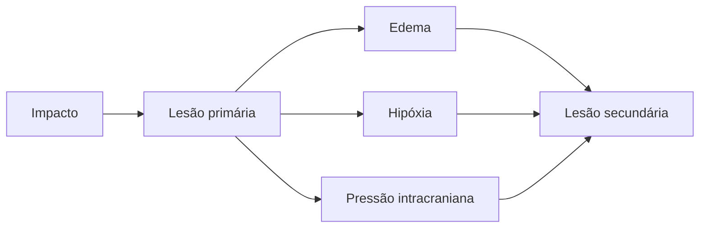

<!--
- Estrutura do encontro: 1 h 30 de quadro, 30 min de intervalo, 30 min de avaliação, 30 min de vinheta e conclusão de laudo em grupo.
- **TCE** — traumatismo cranioencefálico. **ECG** — Escala de Coma de Glasgow.
- **APT** — amnésia pós-traumática. **LAD** — lesão axonal difusa.
-->

---
layout: agenda
kicker: Aula 05 · o caminho de hoje
title: Caminho da aula
items:
  - {
      topic: "O que é o TCE",
      desc: "quem se machuca e como"
    }
  - {
      topic: "Mecanismos de lesão",
      desc: "focal, difusa, primária e secundária"
    }
  - {
      topic: "Gravidade",
      desc: "coma, amnésia pós-traumática e imagem"
    }
  - {
      topic: "O perfil depois do TCE",
      desc: "cognição, comportamento, emoção e consciência"
    }
  - {
      topic: "Do quadro ao laudo",
      desc: "a pergunta do retorno ao trabalho"
    }
---

---
layout: section
index: "01"
kicker: Parte um
title: O que é o TCE
subtitle: Quem se machuca e como.
---

---
layout: define
kicker: A definição
term: Traumatismo cranioencefálico
definition: Alteração da função cerebral, ou outra evidência de patologia
  cerebral, causada por uma <em>força externa</em>.
points:
  - "Impacto, aceleração e desaceleração ou penetração"
  - "Pode haver lesão sem fratura de crânio"
  - "Lesão adquirida, de início súbito"
---

<!--
- Definição do grupo de trabalho de Menon et al. (2010), adotada pela literatura internacional.
- Diferença para o AVC: no AVC o dano segue um território vascular; no TCE ele segue a física do impacto — e costuma ser multifocal e difuso.
-->

---
layout: showcase
kicker: O caso mais famoso
title: Phineas Gage, 1848
subtitle: Um TCE penetrante no lobo frontal. Manteve fala, memória e força, e
  perdeu o controle do próprio comportamento.
image: /phineas-gage.jpg
side: right
alt: Daguerreótipo de Phineas Gage segurando a barra de ferro que lhe atravessou
  o crânio, com a órbita esquerda fechada pela lesão
---

<!--
- A barra entrou pela bochecha esquerda e saiu pelo topo do crânio, lesando o pré-frontal ventromedial. Imagem em domínio público, Wikimedia Commons.
- É o retrato do perfil comportamental do TCE que veremos na parte 4: "já não era Gage".
-->

---
layout: feature
kicker: Quem se machuca
title: Três picos de incidência
columns: 3
features:
  - {
      icon: "lucide:car",
      title: "Adultos jovens",
      desc: "acidentes de trânsito, sobretudo de moto, e violência"
    }
  - {
      icon: "lucide:footprints",
      title: "Idosos",
      desc: "quedas da própria altura"
    }
  - {
      icon: "lucide:baby",
      title: "Crianças pequenas",
      desc: "quedas e maus-tratos"
    }
---

<!--
- Homens jovens são o grupo mais atingido — o mesmo que está entrando no mercado de trabalho. Por isso a pergunta de retorno ao trabalho domina o encaminhamento.
- Álcool está presente em parte importante dos traumas de trânsito e de violência: entra na anamnese.
-->

---
layout: section
index: "02"
kicker: Parte dois
title: Mecanismos de lesão
subtitle: Focal e difusa.
---

---
layout: vs
kicker: Os dois padrões
title: Lesão focal e lesão difusa
left:
  title: "Focal"
  items:
    - "Contusões e hematomas"
    - "Golpe e contragolpe"
    - "Polos frontais e temporais"
    - "Déficit ligado ao local"
right:
  title: "Difusa"
  items:
    - "Lesão axonal difusa"
    - "Estiramento dos axônios na aceleração"
    - "Substância branca, corpo caloso, tronco"
    - "Lentificação e disfunção executiva"
---

<!--
- Por que frontal e temporal? O cérebro desliza dentro do crânio e bate nas superfícies ósseas irregulares da base anterior e da fossa média. Daí o perfil típico: executivo, comportamental e de memória, qualquer que tenha sido o lado do impacto.
- A LAD pode não aparecer na tomografia; a ressonância (sequências de suscetibilidade e tensor de difusão) é mais sensível.
-->

---
layout: diagram
kicker: O que acontece depois do impacto
title: Lesão primária e secundária
---

<!--
- Lesão primária: acontece no momento do trauma e não se trata.
- Lesão secundária: cascata das horas e dias seguintes — edema, hipóxia, hipotensão, aumento da pressão intracraniana. É o alvo da terapia intensiva.
- Consequência para a avaliação: o quadro cognitivo final soma as duas.
-->

---
layout: section
index: "03"
kicker: Parte três
title: Gravidade
subtitle: Coma, amnésia e imagem.
---

---
layout: compare
kicker: Como se classifica
title: Leve, moderado e grave
columns: ["Critério", "Leve", "Moderado", "Grave"]
rows:
  - { metric: "Glasgow inicial", before: "13–15", after: "9–12", delta: "3–8" }
  - { metric: "Perda de consciência", before: "< 30 min", after: "30 min a 24 h", delta: "> 24 h" }
  - { metric: "Amnésia pós-traumática", before: "< 24 h", after: "1 a 7 dias", delta: "> 7 dias" }
---

<!--
- A Escala de Coma de Glasgow soma abertura ocular (1–4), resposta verbal (1–5) e resposta motora (1–6): de 3 a 15.
- Quando os critérios discordam, classifica-se pelo mais grave.
- A duração da APT é o melhor preditor isolado de desfecho cognitivo e funcional.
-->

---
layout: define
kicker: O preditor mais forte
term: Amnésia pós-traumática
definition: Período depois do trauma em que o paciente está <em>confuso</em>,
  desorientado e incapaz de formar memórias contínuas.
points:
  - "Termina quando volta a memória do dia a dia"
  - "Mede-se diariamente com escalas de orientação"
  - "Avaliação formal só depois que ela termina"
---

<!--
- Escalas: Galveston Orientation and Amnesia Test (GOAT) e Westmead.
- Aplicar bateria durante a APT é um erro clássico: o paciente vai mal em tudo e o resultado não descreve nada além da própria APT.
- Amnésia retrógrada: o paciente perde também o período antes do trauma — geralmente segundos a minutos; mais longa nos graves.
-->

---
layout: default
kicker: Fixação · pergunta 1
title: Avaliar quando
---

Rapaz de 23 anos, TCE grave em acidente de moto, internado há 10 dias. Já conversa, mas a
cada manhã pergunta à mãe onde está e por quê. A equipe pede avaliação neuropsicológica
completa. Qual a conduta?

<v-clicks>

- **A.** Aplicar a bateria completa: ele já conversa
- **B.** Acompanhar a orientação com escala diária e adiar a bateria
- **C.** Aplicar só testes de memória, que é o que está falhando
- **D.** Recusar a avaliação até a alta hospitalar

</v-clicks>

---
layout: default
kicker: Fixação · resposta 1
title: A resposta é B
---

<Grid head highlight="row:3" :data="[
  ['', 'Alternativa', 'Por que erra — ou por que acerta'],
  ['A', 'Bateria completa', 'ele ainda está em amnésia pós-traumática; o resultado não descreve o déficit'],
  ['B', 'Escala diária', '<b>correta</b> — monitora-se o fim da APT; a duração dela é dado de prognóstico'],
  ['C', 'Só memória', 'a falha é global, de orientação e formação de memória contínua'],
  ['D', 'Recusar', 'o neuropsicólogo já contribui medindo a APT no hospital'],
]" />

---
layout: section
index: "04"
kicker: Parte quatro
title: O perfil depois do TCE
subtitle: Cognição, comportamento e emoção.
---

---
layout: panels
kicker: O perfil típico
title: Cinco domínios mais afetados
panels:
  - {
      icon: "lucide:gauge",
      title: "Velocidade e atenção",
      body: "Lentificação, dificuldade de dividir a atenção, fadiga."
    }
  - {
      icon: "lucide:database",
      title: "Memória",
      body: "Aprendizagem nova e memória prospectiva, sobretudo."
    }
  - {
      icon: "lucide:workflow",
      title: "Funções executivas",
      body: "Planejamento, iniciativa, controle inibitório, autorregulação."
    }
  - {
      icon: "lucide:users",
      title: "Cognição social",
      body: "Reconhecer emoções e ajustar a conduta ao contexto."
    }
---

<!--
- O padrão vem dos dois mecanismos: a LAD responde pela velocidade; as contusões frontotemporais, pela memória e pelo comportamento.
- Linguagem formal costuma estar preservada; o que falha é a pragmática — o discurso tangencial, a dificuldade de manter o tema.
-->

---
layout: columns
kicker: O que a família relata
title: Comportamento e emoção
columns:
  - {
      title: "Desinibição",
      items: [
        "“Fala o que vem à cabeça”",
        "Irritabilidade e explosões",
        "Impulsividade com dinheiro"
      ]
    }
  - {
      title: "Apatia",
      items: [
        "“Fica o dia no sofá”",
        "Não começa nada sozinho",
        "Parece indiferente"
      ]
    }
  - {
      title: "Emoção",
      items: [
        "Depressão e ansiedade",
        "Estresse pós-traumático",
        "Uso de álcool"
      ]
    }
---

<!--
- "Não é mais a mesma pessoa" é a frase mais ouvida das famílias. É Phineas Gage de novo (aula 01).
- As mudanças de comportamento são o principal fator de sobrecarga do cuidador e de perda de vínculos — mais do que os déficits cognitivos.
-->

---
layout: define
kicker: O obstáculo da reabilitação
term: Anosognosia no TCE
definition: Consciência <em>reduzida</em> das próprias dificuldades depois da
  lesão.
points:
  - "O paciente se avalia melhor do que a família o avalia"
  - "Prejudica adesão e retorno ao trabalho"
  - "Mede-se comparando paciente e informante"
---

<!--
- Diferente da negação psicológica: a anosognosia é déficit neurológico (lesão frontal e parietal direita); a negação é defesa. Na prática se misturam.
- Instrumento clássico: Patient Competency Rating Scale, preenchida pelo paciente e pelo familiar — a diferença entre os dois é a medida.
- Volta na aula 15: treino de autoconsciência é técnica de reabilitação.
-->

---
layout: vs
kicker: O TCE leve
title: Concussão
left:
  title: "O esperado"
  items:
    - "Sintomas nas primeiras semanas"
    - "Dor de cabeça, tontura, lentidão"
    - "A maioria se recupera em até 3 meses"
right:
  title: "Quando persiste"
  items:
    - "Sintomas além de 3 meses"
    - "Peso de humor, sono e dor"
    - "Expectativa e litígio influenciam"
---

<!--
- Sintomas persistentes pós-concussão são multifatoriais. Na avaliação, investigar ansiedade, depressão, sono, dor e medicação antes de atribuir tudo à lesão.
- Validade de desempenho: em contexto de perícia ou indenização, incluir medidas de esforço (por exemplo, Test of Memory Malingering). O tema volta na aula 06.
- Concussões repetidas em esporte de contato: risco de encefalopatia traumática crônica — tema de pesquisa, não de diagnóstico em vida.
-->

---
layout: default
kicker: Fixação · pergunta 2
title: Ele diz que vai voltar segunda
---

Técnico de manutenção, 35 anos, TCE moderado há seis meses. Diz estar pronto para o trabalho.
A esposa conta que ele esquece de desligar o fogão e se irrita no trânsito. Nos testes:
velocidade e memória prospectiva abaixo da norma. Qual o principal achado para o laudo?

<v-clicks>

- **A.** Ele está apto: a decisão é dele
- **B.** Há consciência reduzida dos déficits, que pesa no retorno ao trabalho
- **C.** A queixa da esposa é exagerada e deve ser desconsiderada
- **D.** Os déficits indicam simulação

</v-clicks>

---
layout: default
kicker: Fixação · resposta 2
title: A resposta é B
---

<Grid head highlight="row:3" :data="[
  ['', 'Alternativa', 'Por que erra — ou por que acerta'],
  ['A', 'Está apto', 'a autoavaliação dele diverge dos testes e do informante'],
  ['B', 'Consciência reduzida', '<b>correta</b> — a diferença entre ele, a esposa e os testes é o achado'],
  ['C', 'Esposa exagera', 'o relato bate com os testes de memória prospectiva'],
  ['D', 'Simulação', 'quem simula tende a exagerar o déficit, e não a negá-lo'],
]" />

---
layout: steps
kicker: A avaliação
title: Avaliar depois do TCE
steps:
  - {
      icon: "lucide:file-search",
      title: "Gravidade",
      desc: "Glasgow, duração da APT e imagem no prontuário"
    }
  - {
      icon: "lucide:clipboard-list",
      title: "Bateria",
      desc: "velocidade, atenção, memória, executivas e cognição social"
    }
  - {
      icon: "lucide:users",
      title: "Informante",
      desc: "comportamento, autoconsciência e rotina"
    }
  - {
      icon: "lucide:heart",
      title: "Humor e validade",
      desc: "depressão, ansiedade, TEPT, álcool e esforço"
    }
  - {
      icon: "lucide:briefcase",
      title: "Exigências da vida",
      desc: "o que o trabalho e a casa pedem"
    }
---

<!--
- O último passo é o que transforma avaliação em resposta: o teste diz "velocidade z −2"; o laudo diz se isso cabe numa função que exige atenção dividida e decisões rápidas.
-->

---
layout: section
index: "05"
kicker: Parte cinco
title: Do quadro ao laudo
subtitle: O retorno ao trabalho.
---

---
layout: default
kicker: Vinheta clínica
aside: "vinheta clínica"
title: Sr. Rodrigo, 29 anos
---

Motoboy. TCE grave em acidente de trânsito há oito meses; Glasgow 7 na chegada e
amnésia pós-traumática de 12 dias. Encaminhado pelo médico do trabalho.

<Callout icon="lucide:message-square">A pergunta: <strong>ele pode voltar a pilotar moto profissionalmente?</strong></Callout>

<!--
- A ficha completa está em `referencias/aula-05/vinheta-sr-rodrigo.docx`, com escores, relato da companheira e autoavaliação.
-->

---
layout: compare
kicker: Vinheta clínica
title: Os achados do Sr. Rodrigo
columns: ["Domínio", "Resultado", "Norma", "Leitura"]
rows:
  - { metric: "Velocidade", before: "Códigos 4", after: "ponderado", delta: "rebaixada" }
  - { metric: "Atenção dividida", before: "Trilhas B 190 s", after: "z −2,4", delta: "rebaixada" }
  - { metric: "Memória verbal", before: "RAVLT tardia 7", after: "z −1,2", delta: "limítrofe" }
  - { metric: "Inibição", before: "Stroop, muitos erros", after: "z −2,0", delta: "rebaixada" }
  - { metric: "Autoconsciência", before: "ele 8/10, companheira 4/10", after: "—", delta: "reduzida" }
---

<!--
- O que os grupos precisam notar: a pergunta é sobre uma atividade de alto risco que depende justamente de velocidade, atenção dividida e inibição.
- Exemplo de conclusão: "O perfil é compatível com as sequelas de TCE grave com lesão axonal difusa: lentificação, déficit de atenção dividida e de controle inibitório, memória verbal limítrofe e consciência reduzida das dificuldades. No momento, o desempenho é incompatível com a condução profissional de motocicleta. Recomenda-se reabilitação neuropsicológica, avaliação de outras funções laborais em conjunto com terapia ocupacional e reavaliação em seis meses."
-->

---
layout: statement
kicker: Dinâmica em grupo
title: Respondam à pergunta do médico do trabalho na <em>conclusão</em> do laudo.
---

<!--
- Lembre o roteiro da aula 04: pergunta, perfil, quadro, rotina, recomendação.
- Ponto ético para discutir no fim: o laudo não demite nem readmite ninguém. Descreve a capacidade para a função; a decisão é do médico do trabalho.
-->

---
layout: panels
kicker: Para levar
title: Três coisas que ficam
panels:
  - {
      icon: "lucide:move",
      title: "Física do impacto",
      body: "Contusões <strong>frontotemporais</strong> e lesão axonal difusa,
        qualquer que seja o lado."
    }
  - {
      icon: "lucide:timer",
      title: "APT é o relógio",
      body: "Prediz o desfecho e diz quando a avaliação formal pode começar."
    }
  - {
      icon: "lucide:eye-off",
      title: "O paciente não vê",
      body: "Anosognosia e mudança de conduta pesam mais do que o escore."
    }
---

---
layout: reference
kicker: Referências
title: Base desta aula
items:
  - {
      term: "Menon et al., 2010",
      desc: "Position statement: definition of traumatic brain injury. <em>Archives of
        Physical Medicine and Rehabilitation</em>, 91(11), 1637-1640.
        doi:10.1016/j.apmr.2010.05.017"
    }
  - {
      term: "Teasdale et al., 2014",
      desc: "The Glasgow Coma Scale at 40 years: standing the test of time. <em>The
        Lancet Neurology</em>, 13(8), 844-854."
    }
  - {
      term: "Ponsford, 2013",
      desc: "Factors contributing to outcome following traumatic brain injury.
        <em>NeuroRehabilitation</em>, 32(4), 803-815."
    }
  - {
      term: "Prigatano, 2005",
      desc: "Disturbances of self-awareness and rehabilitation of patients with
        traumatic brain injury. <em>Journal of Head Trauma Rehabilitation</em>,
        20(1), 19-29."
    }
  - {
      term: "Malloy-Diniz et al., 2016",
      desc: "<em>Avaliação neuropsicológica</em>. 2ª ed. Porto Alegre: Artmed. Capítulo
        sobre traumatismo cranioencefálico."
    }
---
