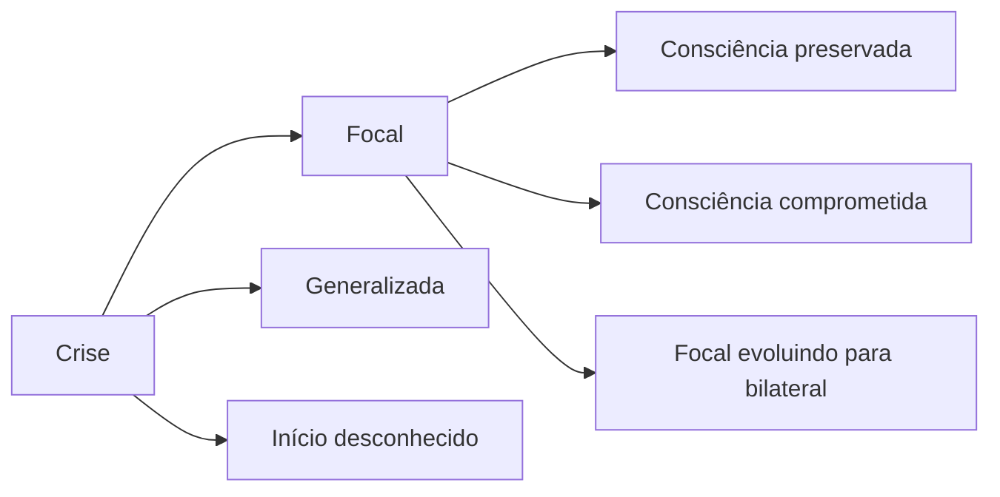

<!--
- Estrutura do encontro: 1 h 30 de quadro, 30 min de intervalo, 30 min de avaliação pré-cirúrgica, 30 min de vinheta e laudo.
- **ILAE** — *International League Against Epilepsy*, Liga Internacional contra a Epilepsia.
- **ELT** — epilepsia do lobo temporal. **EH** — esclerose hipocampal.
- **FAE** — fármaco antiepiléptico (hoje também chamado anticrise).
- **EEG** — eletroencefalograma.
-->

---
layout: agenda
kicker: Aula 12 · o caminho de hoje
title: Caminho da aula
items:
  - {
      topic: "Crise e epilepsia",
      desc: "definição e classificação"
    }
  - {
      topic: "Epilepsia do lobo temporal",
      desc: "o quadro e a memória"
    }
  - {
      topic: "O que afeta a cognição",
      desc: "lesão, crises, remédio e humor"
    }
  - {
      topic: "A avaliação pré-cirúrgica",
      desc: "lateralizar, prever, decidir"
    }
  - {
      topic: "Do quadro ao laudo",
      desc: "a vinheta"
    }
---

---
layout: section
index: "01"
kicker: Parte um
title: Crise e epilepsia
subtitle: Definição e classificação.
---

---
layout: vs
kicker: Duas palavras que não são sinônimas
title: Crise e epilepsia
left:
  title: "Crise epiléptica"
  items:
    - "Evento transitório"
    - "Atividade neuronal excessiva e sincrônica"
    - "Pode ocorrer uma vez, por febre, álcool, hipoglicemia"
right:
  title: "Epilepsia"
  items:
    - "Doença do cérebro"
    - "Predisposição duradoura a gerar crises"
    - "Duas crises não provocadas, ou uma com alto risco de outra"
---

<!--
- Definição clínica operacional da ILAE (Fisher et al., 2014).
- Cerca de 50 milhões de pessoas no mundo têm epilepsia (OMS). Afeta todas as idades, com picos na infância e depois dos 60 anos — onde AVC e demência passam a ser causas frequentes.
-->

---
layout: diagram
kicker: ILAE, 2017
title: Onde a crise começa
---

<!--
- Focal: começa numa rede de um hemisfério. É a que mais interessa à neuropsicologia, porque o déficit cognitivo costuma ter o endereço do foco.
- Generalizada: começa nas duas redes ao mesmo tempo. Ausências na infância, tônico-clônicas generalizadas.
- Os termos antigos "parcial simples" e "parcial complexa" correspondem a focal consciente e focal com comprometimento da consciência (Fisher et al., 2017).
-->

---
layout: feature
kicker: As causas
title: As seis etiologias da ILAE
columns: 3
features:
  - {
      icon: "lucide:scan-line",
      title: "Estrutural",
      desc: "AVC, TCE, tumor, esclerose hipocampal, malformação"
    }
  - {
      icon: "lucide:dna",
      title: "Genética",
      desc: "mutação conhecida ou presumida"
    }
  - {
      icon: "lucide:bug",
      title: "Infecciosa",
      desc: "neurocisticercose, meningite, encefalite"
    }
  - {
      icon: "lucide:flask-conical",
      title: "Metabólica",
      desc: "distúrbios bioquímicos"
    }
  - {
      icon: "lucide:shield",
      title: "Imune",
      desc: "encefalites autoimunes"
    }
  - {
      icon: "lucide:circle-help",
      title: "Desconhecida",
      desc: "ainda sem causa identificada"
    }
---

<!--
- Scheffer et al. (2017). Uma pessoa pode ter mais de uma etiologia.
- Neurocisticercose (larva da *Taenia solium*) é causa importante de epilepsia no Brasil e em toda a América Latina.
- Ponte com as aulas anteriores: AVC (04) e TCE (05) são causas estruturais de epilepsia no adulto.
-->

---
layout: section
index: "02"
kicker: Parte dois
title: Epilepsia do lobo temporal
subtitle: O quadro e a memória.
---

---
layout: define
kicker: A epilepsia focal mais comum do adulto
term: Epilepsia do lobo temporal mesial
definition: Crises que começam no <em>hipocampo</em> e nas estruturas vizinhas,
  em geral por esclerose hipocampal.
points:
  - "Aura: sensação no estômago, medo, déjà-vu"
  - "Olhar parado, automatismos com a boca e as mãos"
  - "Confusão e amnésia depois da crise"
---

<!--
- Esclerose hipocampal: perda neuronal e gliose no hipocampo, visível na ressonância como atrofia e hipersinal. Muitas vezes há história de convulsão febril prolongada na infância.
- É a forma que mais resiste aos remédios — e a que tem melhor resultado cirúrgico. Por isso é o centro da avaliação pré-cirúrgica.
-->

---
layout: vs
kicker: A regra da lateralidade
title: Hipocampo esquerdo e direito
left:
  title: "Temporal esquerdo"
  items:
    - "Memória verbal: listas e histórias"
    - "Nomeação e busca de palavras"
    - "Queixa: “esqueço o que me contam”"
right:
  title: "Temporal direito"
  items:
    - "Memória visual e espacial"
    - "Reconhecimento de rostos"
    - "Achados menos consistentes"
---

<!--
- Em destros, a regra para o lado esquerdo é robusta: RAVLT e Memória Lógica rebaixados apontam o foco. A memória visual é menos lateralizada, em parte porque as figuras podem ser nomeadas e codificadas verbalmente.
- A anomia na ELT esquerda é frequente e sutil: o paciente "tem a palavra na ponta da língua".
-->

---
layout: default
kicker: Fixação · pergunta 1
title: Ele esquece o que a esposa conta
---

Homem destro, 34 anos, crises desde os 12 com aura de "frio na barriga". Nos testes:
RAVLT tardia z −2,3, Memória Lógica tardia z −2,0, Figura de Rey reprodução z −0,2 e Boston
z −1,6. Onde está o foco mais provável?

<v-clicks>

- **A.** Lobo frontal direito
- **B.** Lobo temporal mesial esquerdo
- **C.** Lobo temporal mesial direito
- **D.** Lobo occipital esquerdo

</v-clicks>

---
layout: default
kicker: Fixação · resposta 1
title: A resposta é B
---

<Grid head highlight="row:3" :data="[
  ['', 'Alternativa', 'Por que erra — ou por que acerta'],
  ['A', 'Frontal direito', 'daria perfil executivo; a falha aqui é de armazenamento verbal'],
  ['B', 'Temporal esquerdo', '<b>correta</b> — memória verbal e nomeação alteradas, memória visual preservada, aura epigástrica'],
  ['C', 'Temporal direito', 'a memória visual está na média'],
  ['D', 'Occipital esquerdo', 'produziria sintomas visuais, não perfil amnéstico verbal'],
]" />

---
layout: section
index: "03"
kicker: Parte três
title: O que afeta a cognição
subtitle: Lesão, crises, remédio e humor.
---

---
layout: panels
kicker: As quatro fontes do déficit
title: Por que a pessoa com epilepsia vai mal no teste
panels:
  - {
      icon: "lucide:scan-line",
      title: "A lesão",
      body: "A causa da epilepsia já tira função: esclerose, tumor, cicatriz."
    }
  - {
      icon: "lucide:zap",
      title: "As crises",
      body: "Frequência, duração e descargas entre as crises."
    }
  - {
      icon: "lucide:pill",
      title: "O remédio",
      body: "Alguns FAE lentificam e prejudicam a linguagem."
    }
  - {
      icon: "lucide:cloud-rain",
      title: "O humor",
      body: "Depressão e ansiedade frequentes e pouco tratadas."
    }
---

<!--
- Topiramato é o exemplo clássico de FAE com efeito cognitivo: fluência verbal e velocidade. Fenobarbital e politerapia também pesam. Lamotrigina e levetiracetam costumam ter perfil mais favorável (o levetiracetam pode trazer irritabilidade).
- Avaliar logo depois de uma crise mede a confusão pós-ictal, não o perfil basal. Registre a data da última crise.
-->

---
layout: columns
kicker: Comorbidade psiquiátrica
title: O que acompanha a epilepsia
columns:
  - {
      title: "Humor",
      items: [
        "Depressão em cerca de 1 em cada 4",
        "Risco aumentado de suicídio",
        "Ansiedade antecipatória da crise"
      ]
    }
  - {
      title: "Psicose",
      items: [
        "Pós-ictal, dias depois de salvas",
        "Mais comum na ELT"
      ]
    }
  - {
      title: "Crises não epilépticas",
      items: [
        "Psicogênicas: parecem crise sem descarga",
        "Diagnóstico com vídeo-EEG",
        "Podem coexistir com epilepsia"
      ]
    }
---

<!--
- A relação entre epilepsia e depressão é bidirecional: a depressão também aumenta o risco de epilepsia (Kanner, 2016).
- Crises não epilépticas psicogênicas são transtorno funcional (conversivo). O psicólogo é parte central do tratamento.
- O estigma ainda é grande: medo de convulsionar em público, restrição para dirigir, demissão. Entra na anamnese e no plano de cuidado.
-->

---
layout: section
index: "04"
kicker: Parte quatro
title: A avaliação pré-cirúrgica
subtitle: Lateralizar, prever, decidir.
---

---
layout: define
kicker: Quando a cirurgia entra
term: Epilepsia farmacorresistente
definition: Persistência das crises depois de dois FAE <em>adequados</em>, bem
  tolerados e usados corretamente.
points:
  - "Cerca de um terço das pessoas com epilepsia"
  - "Na ELT com esclerose, a cirurgia controla as crises em muitos casos"
  - "A avaliação neuropsicológica é parte obrigatória do protocolo"
---

<!--
- Definição de Kwan et al. (2010), ILAE.
- O ensaio clássico de Wiebe et al. (2001) mostrou superioridade da lobectomia temporal sobre a manutenção apenas do tratamento clínico.
-->

---
layout: steps
kicker: O papel do neuropsicólogo
title: Três perguntas da equipe de cirurgia
steps:
  - {
      icon: "lucide:map-pin",
      title: "O perfil confirma o lado?",
      desc: "a lateralidade dos testes bate com EEG e ressonância"
    }
  - {
      icon: "lucide:message-square",
      title: "Onde está a linguagem?",
      desc: "RM funcional ou teste de Wada"
    }
  - {
      icon: "lucide:trending-down",
      title: "Quanto se pode perder?",
      desc: "risco de declínio de memória e de nomeação após a cirurgia"
    }
---

<!--
- **Teste de Wada** — injeção de amobarbital numa carótida, que "anestesia" um hemisfério por minutos enquanto se testam linguagem e memória. Hoje é cada vez mais substituído pela ressonância funcional.
- Regra do risco: quanto melhor a memória antes da cirurgia e quanto mais o tecido operado ainda funciona, maior o risco de perda. Paciente com memória verbal preservada e cirurgia temporal esquerda é o de maior risco.
-->

---
layout: default
kicker: Previsão de risco
title: Quem mais pode perder memória verbal
---

<Grid head :data="[
  ['Fator', 'Menor risco', 'Maior risco'],
  ['Lado operado', 'direito', 'esquerdo, dominante para linguagem'],
  ['Memória antes da cirurgia', 'já rebaixada', 'preservada'],
  ['Ressonância', 'esclerose hipocampal clara', 'sem lesão visível'],
  ['Idade na cirurgia', 'mais jovem', 'mais velho'],
]" />

<!--
- Sherman et al. (2011), revisão do declínio cognitivo após cirurgia de epilepsia.
- A avaliação pós-cirúrgica, em geral de 6 a 12 meses depois, documenta o que mudou e orienta reabilitação. Há pacientes que melhoram, quando as crises param e a medicação diminui.
-->

---
layout: section
index: "05"
kicker: Parte cinco
title: Do quadro ao laudo
subtitle: A vinheta.
---

---
layout: default
kicker: Vinheta clínica
aside: "vinheta clínica"
title: Sra. Luana, 31 anos
---

Bancária, destra. Crises focais desde os 15 anos, sem controle com três FAE. Ressonância
com esclerose hipocampal esquerda. Encaminhada pelo neurocirurgião.

<Callout icon="lucide:message-square">A pergunta: <strong>o perfil é compatível com o foco? Qual o risco cognitivo da cirurgia?</strong></Callout>

<!--
- A ficha completa está em `referencias/aula-12/vinheta-sra-luana.docx`.
- O que os grupos precisam notar: memória verbal na média baixa (não muito rebaixada), nomeação levemente alterada, memória visual preservada, humor deprimido leve. Perfil concordante com o foco esquerdo, mas com memória verbal ainda funcional — risco moderado a alto de declínio verbal após lobectomia temporal esquerda.
- Exemplo de conclusão: "O perfil é concordante com disfunção temporal mesial esquerda, com memória verbal na faixa média inferior, leve dificuldade de nomeação e memória visual preservada. Por ainda haver função de memória verbal, há risco de declínio após a cirurgia temporal esquerda, que deve ser discutido com a paciente. Recomenda-se acompanhamento do humor e reavaliação seis meses após o procedimento."
-->

---
layout: statement
kicker: Dinâmica em grupo
title: Escrevam a conclusão para o <em>neurocirurgião</em> e digam como explicariam o risco à paciente.
---

<!--
- A segunda parte treina devolutiva: a paciente vai decidir sobre a cirurgia. Linguagem simples, sem prometer nem assustar.
-->

---
layout: panels
kicker: Para levar
title: Três coisas que ficam
panels:
  - {
      icon: "lucide:map-pin",
      title: "O foco tem endereço",
      body: "Temporal esquerdo, <strong>memória verbal</strong>; temporal direito,
        visual, com menos consistência."
    }
  - {
      icon: "lucide:layers",
      title: "Quatro fontes",
      body: "Lesão, crises, remédio e humor. Descarte cada uma antes de concluir."
    }
  - {
      icon: "lucide:scale",
      title: "Pré-cirúrgico é previsão",
      body: "Quem tem mais função a perder tem <strong>maior risco</strong>."
    }
---

---
layout: reference
kicker: Referências
title: Base desta aula
items:
  - {
      term: "Fisher et al., 2014",
      desc: "ILAE official report: a practical clinical definition of epilepsy.
        <em>Epilepsia</em>, 55(4), 475-482. doi:10.1111/epi.12550"
    }
  - {
      term: "Fisher et al., 2017",
      desc: "Operational classification of seizure types by the ILAE.
        <em>Epilepsia</em>, 58(4), 522-530. doi:10.1111/epi.13670"
    }
  - {
      term: "Scheffer et al., 2017",
      desc: "ILAE classification of the epilepsies. <em>Epilepsia</em>, 58(4),
        512-521. doi:10.1111/epi.13709"
    }
  - {
      term: "Sherman et al., 2011",
      desc: "Neuropsychological outcomes after epilepsy surgery: systematic review
        and pooled estimates. <em>Epilepsia</em>, 52(5), 857-869."
    }
  - {
      term: "Kanner, 2016",
      desc: "Management of psychiatric and neurological comorbidities in epilepsy.
        <em>Nature Reviews Neurology</em>, 12(2), 106-116."
    }
---
