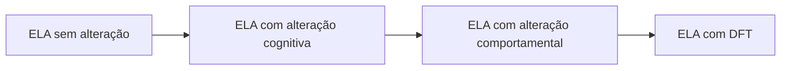

<!--
- Estrutura do encontro: 1 h 10 de esclerose múltipla, 30 min de ELA, 30 min de intervalo, 20 min de avaliação, 30 min de vinheta e laudo.
- **EM** — esclerose múltipla. **ELA** — esclerose lateral amiotrófica. **DFT** — demência frontotemporal.
- **SDMT** — *Symbol Digit Modalities Test*. **BICAMS** — *Brief International Cognitive Assessment for MS*.
- **ECAS** — *Edinburgh Cognitive and Behavioural ALS Screen*.
- O nome "esclerose" vem das cicatrizes endurecidas que os patologistas viam no tecido — nas duas doenças. Fora isso, são doenças diferentes.
-->

---
layout: agenda
kicker: Aula 13 · o caminho de hoje
title: Caminho da aula
items:
  - {
      topic: "Esclerose múltipla",
      desc: "a doença e os seus fenótipos"
    }
  - {
      topic: "A cognição na EM",
      desc: "velocidade, memória, fadiga e humor"
    }
  - {
      topic: "ELA",
      desc: "do neurônio motor ao lobo frontal"
    }
  - {
      topic: "Avaliar com o corpo limitado",
      desc: "instrumentos que não dependem da mão nem da fala"
    }
  - {
      topic: "Do quadro ao laudo",
      desc: "a vinheta"
    }
---

---
layout: section
index: "01"
kicker: Parte um
title: Esclerose múltipla
subtitle: A doença e os seus fenótipos.
---

---
layout: define
kicker: A definição
term: Esclerose múltipla
definition: Doença <em>inflamatória</em> e <em>desmielinizante</em> do sistema
  nervoso central, de origem autoimune.
points:
  - "Placas de desmielinização espalhadas no tempo e no espaço"
  - "Começa em geral entre 20 e 40 anos"
  - "Mais frequente em mulheres, cerca de 3 para 1"
---

<!--
- A mielina é a bainha que isola o axônio e acelera o impulso. Sem ela, a condução fica lenta ou bloqueada — é a explicação mais direta para a lentificação cognitiva.
- Diagnóstico pelos critérios de McDonald (Thompson et al., 2018): disseminação no tempo e no espaço, com ressonância e às vezes líquor.
- Sintomas iniciais comuns: neurite óptica (perda visual dolorosa de um olho), formigamentos, fraqueza, desequilíbrio.
-->

---
layout: columns
kicker: Os fenótipos
title: Como a doença evolui
columns:
  - {
      title: "Remitente-recorrente",
      items: [
        "Surtos e recuperação",
        "Cerca de 85% no início",
        "Responde aos tratamentos modificadores"
      ]
    }
  - {
      title: "Secundariamente progressiva",
      items: [
        "Surge depois da remitente",
        "Piora contínua, com ou sem surtos",
        "Cognição mais comprometida"
      ]
    }
  - {
      title: "Primariamente progressiva",
      items: [
        "Piora desde o início",
        "Cerca de 10 a 15%",
        "Início mais tardio"
      ]
    }
---

<!--
- Classificação de Lublin et al. (2014), que acrescenta os qualificadores "ativa" e "em progressão".
- **Síndrome clinicamente isolada** — primeiro episódio sugestivo, ainda sem preencher critérios.
-->

---
layout: section
index: "02"
kicker: Parte dois
title: A cognição na EM
subtitle: Velocidade, memória, fadiga e humor.
---

---
layout: stats
kicker: A dimensão do problema
title: Cognição na esclerose múltipla
stats:
  - { value: 65, unit: "%", label: "têm comprometimento cognitivo em algum momento", tone: warn }
  - { value: 1, unit: "º", label: "domínio afetado: velocidade de processamento", tone: info }
  - { value: 80, unit: "%", label: "relatam fadiga", tone: bad }
---

<!--
- Prevalência entre 43% e 70% conforme a amostra (Chiaravalloti e DeLuca, 2008); 65% é a estimativa usual para o meio dessa faixa.
- A cognição pode estar alterada mesmo com pouca incapacidade motora, e é um dos principais motivos de perda do emprego.
-->

---
layout: panels
kicker: O perfil típico
title: O que cai na EM
panels:
  - {
      icon: "lucide:gauge",
      title: "Velocidade",
      body: "O achado central. Mede-se com o SDMT."
    }
  - {
      icon: "lucide:database",
      title: "Memória",
      body: "Aprendizagem lenta, com falha de <strong>aquisição</strong> e evocação."
    }
  - {
      icon: "lucide:workflow",
      title: "Executivas",
      body: "Memória operacional e flexibilidade."
    }
  - {
      icon: "lucide:check",
      title: "Preservados",
      body: "Linguagem, inteligência geral e memória semântica."
    }
---

<!--
- O padrão é subcortical: lesão da substância branca desconecta regiões corticais. Lembra o vascular de pequenos vasos — e o oposto do Alzheimer, cortical.
- Na memória, com mais repetições o paciente chega lá: o problema é mais de velocidade de aprendizagem que de armazenamento. Reconhecimento costuma ser melhor que evocação.
-->

---
layout: vs
kicker: Os vizinhos da cognição
title: Fadiga e depressão
left:
  title: "Fadiga"
  items:
    - "Exaustão desproporcional ao esforço"
    - "Piora com o calor e ao longo do dia"
    - "Rebaixa testes longos e cronometrados"
right:
  title: "Depressão"
  items:
    - "Até metade das pessoas ao longo da vida"
    - "Parte é reação, parte é lesão"
    - "Piora velocidade e memória"
---

<!--
- Fadiga cognitiva: o desempenho cai no fim da sessão. Sessões curtas, testes cronometrados no começo e registro da hora no laudo.
- Fenômeno de Uhthoff: piora temporária dos sintomas com o aumento da temperatura corporal — banho quente, febre, exercício.
- Escalas: Escala Modificada de Impacto da Fadiga; inventários de depressão com cuidado nos itens somáticos, que se confundem com a doença.
-->

---
layout: default
kicker: O protocolo breve
title: BICAMS
---

<Grid head :data="[
  ['Teste', 'Domínio', 'Tempo'],
  ['SDMT, versão oral', 'velocidade de processamento', '5 min'],
  ['California Verbal Learning Test II, cinco ensaios', 'memória verbal', '10 min'],
  ['Brief Visuospatial Memory Test-R', 'memória visuoespacial', '5 min'],
]" highlight="row:2" />

<Callout icon="lucide:info">O SDMT oral é o teste mais sensível e o mais usado no acompanhamento.</Callout>

<!--
- Langdon et al. (2012) propuseram o BICAMS para ser aplicado por qualquer profissional treinado em cerca de 15 minutos.
- Há estudo de validação brasileiro (Spedo et al., 2015).
- O SDMT oral contorna a dificuldade motora de mão e a incoordenação: o paciente fala os números.
-->

---
layout: default
kicker: Fixação · pergunta 1
title: Ela chega cansada à tarde
---

Professora, 36 anos, EM remitente-recorrente há 8 anos. Diz que "o raciocínio ficou
lento" e que no fim do dia "não consegue corrigir provas". O que é mais coerente com o quadro?

<v-clicks>

- **A.** Afasia de expressão por placa no lobo frontal
- **B.** Lentificação do processamento agravada pela fadiga
- **C.** Amnésia com falha de armazenamento, como no Alzheimer
- **D.** Queixa sem base orgânica, a investigar como ansiedade

</v-clicks>

---
layout: default
kicker: Fixação · resposta 1
title: A resposta é B
---

<Grid head highlight="row:3" :data="[
  ['', 'Alternativa', 'Por que erra — ou por que acerta'],
  ['A', 'Afasia', 'a linguagem é das funções mais preservadas na EM'],
  ['B', 'Lentificação e fadiga', '<b>correta</b> — o domínio central da EM, piorando ao longo do dia'],
  ['C', 'Amnésia de armazenamento', 'na EM a falha é de aquisição e evocação, não de armazenamento'],
  ['D', 'Sem base orgânica', 'a queixa é típica da doença; humor se investiga junto, não no lugar'],
]" />

---
layout: section
index: "03"
kicker: Parte três
title: Esclerose lateral amiotrófica
subtitle: Do neurônio motor ao lobo frontal.
---

---
layout: define
kicker: A definição
term: Esclerose lateral amiotrófica
definition: Doença <em>neurodegenerativa</em> progressiva dos neurônios motores
  superiores e inferiores.
points:
  - "Fraqueza, atrofia e espasticidade"
  - "Fala, deglutição e respiração comprometidas"
  - "Sobrevida média de 3 a 5 anos após os sintomas"
---

<!--
- Início típico entre 50 e 70 anos. Stephen Hawking teve uma forma de evolução atipicamente lenta.
- Começa nos membros (espinhal) ou na fala e deglutição (bulbar). A forma bulbar torna a avaliação verbal difícil desde cedo.
-->

---
layout: diagram
kicker: O espectro
title: Da ELA pura à demência frontotemporal
---

<!--
- Até metade das pessoas com ELA tem alguma alteração cognitiva ou comportamental, e cerca de 15% preenchem critérios de DFT (Strong et al., 2017).
- A proteína TDP-43 é o elo patológico: está presente em quase todos os casos de ELA e em parte das DFT. A expansão do gene C9ORF72 causa as duas — volta à aula 11.
-->

---
layout: columns
kicker: O perfil na ELA
title: O que se procura
columns:
  - {
      title: "Cognição",
      items: [
        "Fluência verbal, a mais sensível",
        "Funções executivas",
        "Linguagem e cognição social"
      ]
    }
  - {
      title: "Comportamento",
      items: [
        "Apatia, a mais frequente",
        "Desinibição e perda de empatia",
        "Rigidez e mudança alimentar"
      ]
    }
  - {
      title: "Preservado",
      items: [
        "Memória, em geral",
        "Visuoespacial"
      ]
    }
---

<!--
- Alteração cognitiva e comportamental na ELA reduz a adesão a ventilação e alimentação por sonda e aumenta a sobrecarga do cuidador.
- O laudo pesa nas decisões de fim de vida: capacidade de decidir sobre traqueostomia e diretivas antecipadas.
-->

---
layout: section
index: "04"
kicker: Parte quatro
title: Avaliar com o corpo limitado
subtitle: Sem depender da mão nem da fala.
---

---
layout: vs
kicker: Adaptar a avaliação
title: EM e ELA
left:
  title: "Na esclerose múltipla"
  items:
    - "Visão: neurite óptica e visão dupla"
    - "Mão: tremor e incoordenação"
    - "Fadiga: sessões curtas"
right:
  title: "Na ELA"
  items:
    - "Fala: respostas escritas ou por apontar"
    - "Mão: respostas faladas ou por olhar"
    - "Fluência: corrigir pelo tempo motor"
---

<!--
- O ECAS (Abrahams et al., 2014) foi desenhado para isso: cada item pode ser respondido falando ou escrevendo, e a fluência é corrigida pelo tempo que a pessoa leva para copiar ou ler as palavras.
- O ECAS avalia linguagem, fluência, executivas (específicas da ELA), memória e visuoespacial (não específicas), e inclui entrevista comportamental com o cuidador.
-->

---
layout: default
kicker: Fixação · pergunta 2
title: A fluência caiu
---

Homem de 58 anos com ELA de início bulbar, fala arrastada. Na fluência fonêmica oral produz
6 palavras por minuto. A esposa diz que ele "perdeu o interesse por tudo". Qual a melhor
conduta para o laudo?

<v-clicks>

- **A.** Concluir disfunção executiva pela fluência baixa
- **B.** Refazer a fluência por escrito, corrigida pelo tempo motor, e investigar apatia com a esposa
- **C.** Concluir depressão, pela perda de interesse
- **D.** Não avaliar, porque a fala está comprometida

</v-clicks>

---
layout: default
kicker: Fixação · resposta 2
title: A resposta é B
---

<Grid head highlight="row:3" :data="[
  ['', 'Alternativa', 'Por que erra — ou por que acerta'],
  ['A', 'Disfunção executiva', 'a disartria explica parte da fluência baixa'],
  ['B', 'Adaptar e investigar', '<b>correta</b> — separa o motor do cognitivo e examina a apatia'],
  ['C', 'Depressão', 'apatia é frequente na ELA e não exige tristeza'],
  ['D', 'Não avaliar', 'há instrumentos adaptados e a avaliação muda decisões'],
]" />

---
layout: section
index: "05"
kicker: Parte cinco
title: Do quadro ao laudo
subtitle: A vinheta.
---

---
layout: default
kicker: Vinheta clínica
aside: "vinheta clínica"
title: Sra. Cláudia, 42 anos
---

Analista de sistemas, EM remitente-recorrente há 10 anos. Afastada há três meses por
"esquecimentos e lentidão". Encaminhada pela neurologista.

<Callout icon="lucide:message-square">A pergunta: <strong>há comprometimento cognitivo? Ela pode retornar à função?</strong></Callout>

<!--
- A ficha completa está em `referencias/aula-13/vinheta-sra-claudia.docx`.
- O que os grupos precisam notar: SDMT z −2,1, CVLT com aprendizagem lenta mas reconhecimento bom, BVMT limítrofe, fadiga elevada, sintomas depressivos leves, desempenho piora na segunda metade da sessão.
- Exemplo de conclusão: "O perfil caracteriza-se por lentificação do processamento e aprendizagem verbal lenta, com reconhecimento preservado, agravados pela fadiga, compatível com o comprometimento cognitivo da esclerose múltipla. Sugere-se retorno gradual, com adaptações (pausas, demandas sem pressão de tempo, tarefas críticas no início do turno), reabilitação cognitiva, manejo da fadiga e acompanhamento do humor, com reavaliação em um ano."
-->

---
layout: statement
kicker: Dinâmica em grupo
title: Escrevam a conclusão e proponham <em>três adaptações</em> para o retorno ao trabalho.
---

<!--
- As adaptações antecipam a aula 15: compensação ambiental é técnica de reabilitação.
-->

---
layout: panels
kicker: Para levar
title: Três coisas que ficam
panels:
  - {
      icon: "lucide:gauge",
      title: "EM é velocidade",
      body: "Lentificação, aprendizagem lenta e <strong>fadiga</strong>. O SDMT
        acompanha."
    }
  - {
      icon: "lucide:git-merge",
      title: "ELA é espectro",
      body: "Até metade tem alteração cognitiva ou comportamental; parte chega à
        <strong>DFT</strong>."
    }
  - {
      icon: "lucide:accessibility",
      title: "Adapte o teste",
      body: "Separe o motor do cognitivo antes de concluir."
    }
---

---
layout: reference
kicker: Referências
title: Base desta aula
items:
  - {
      term: "Chiaravalloti e DeLuca, 2008",
      desc: "Cognitive impairment in multiple sclerosis. <em>The Lancet
        Neurology</em>, 7(12), 1139-1151."
    }
  - {
      term: "Langdon et al., 2012",
      desc: "Recommendations for a Brief International Cognitive Assessment for
        Multiple Sclerosis (BICAMS). <em>Multiple Sclerosis Journal</em>, 18(6),
        891-898."
    }
  - {
      term: "Thompson et al., 2018",
      desc: "Diagnosis of multiple sclerosis: 2017 revisions of the McDonald criteria.
        <em>The Lancet Neurology</em>, 17(2), 162-173."
    }
  - {
      term: "Strong et al., 2017",
      desc: "Amyotrophic lateral sclerosis – frontotemporal spectrum disorder
        (ALS-FTSD): revised diagnostic criteria. <em>Amyotrophic Lateral Sclerosis
        and Frontotemporal Degeneration</em>, 18(3-4), 153-174."
    }
  - {
      term: "Abrahams et al., 2014",
      desc: "Screening for cognition and behaviour changes in ALS. <em>Amyotrophic
        Lateral Sclerosis and Frontotemporal Degeneration</em>, 15(1-2), 9-14."
    }
---
