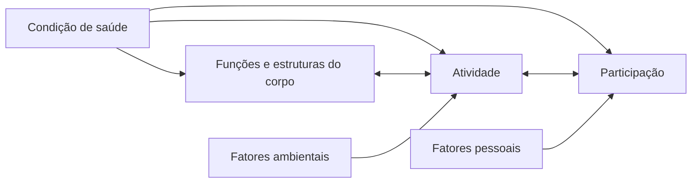

<!--
- Estrutura do encontro: 1 h 30 de fundamentos, 30 min de intervalo, 30 min de CIF e metas, 30 min de exercício de metas em grupo.
- **CIF** — Classificação Internacional de Funcionalidade, Incapacidade e Saúde (OMS, 2001).
- **GAS** — *Goal Attainment Scaling*, escala de alcance de metas.
- Abre o bloco de três aulas de reabilitação que termina no trabalho do filme *Meu Pai*.
-->

---
layout: agenda
kicker: Aula 14 · o caminho de hoje
title: Caminho da aula
items:
  - {
      topic: "O que é reabilitar",
      desc: "definição e história"
    }
  - {
      topic: "Como o cérebro se recupera",
      desc: "plasticidade e seus limites"
    }
  - {
      topic: "Três caminhos",
      desc: "restaurar, compensar, adaptar"
    }
  - {
      topic: "Os modelos",
      desc: "CIF e abordagem holística"
    }
  - {
      topic: "Metas",
      desc: "do problema à meta mensurável"
    }
---

---
layout: section
index: "01"
kicker: Parte um
title: O que é reabilitar
subtitle: Definição e história.
---

---
layout: define
kicker: A definição
term: Reabilitação neuropsicológica
definition: Processo <em>colaborativo</em> que ajuda a pessoa com lesão cerebral
  e sua família a lidar com os déficits cognitivos, emocionais e comportamentais,
  para alcançar o melhor funcionamento possível na <em>vida diária</em>.
points:
  - "A meta é funcional, não o escore do teste"
  - "Inclui cognição, emoção, comportamento e família"
  - "Feita com a pessoa, não para ela"
---

<!--
- Definição de Barbara Wilson, retomada em Wilson et al. (2017).
- Reabilitação cognitiva é parte da neuropsicológica: trata só da cognição. A neuropsicológica é mais ampla.
-->

---
layout: timeline
kicker: De onde vem a área
title: Guerras e lesões
events:
  - { date: "1914–1918", title: "Primeira Guerra", desc: "Goldstein trata soldados com lesão cerebral" }
  - { date: "1939–1945", title: "Segunda Guerra", desc: "Luria e Zangwill reabilitam feridos" }
  - { date: "1970–1980", title: "Programas holísticos", desc: "Ben-Yishay e Prigatano" }
  - { date: "1990–hoje", title: "Prática baseada em evidência", desc: "Wilson, Cicerone e as revisões sistemáticas" }
---

<!--
- Luria escreveu "Restoration of function after brain injury" (1963) a partir da reabilitação de soldados russos.
- Oliver Zangwill, na Inglaterra, propôs as ideias de compensação, substituição e retreinamento direto — os três caminhos da parte 3.
-->

---
layout: section
index: "02"
kicker: Parte dois
title: Como o cérebro se recupera
subtitle: Plasticidade e seus limites.
---

---
layout: define
kicker: O mecanismo
term: Neuroplasticidade
definition: Capacidade do sistema nervoso de <em>modificar</em> sua estrutura e
  função em resposta à experiência e à lesão.
points:
  - "Maior na fase subaguda, depois da lesão"
  - "Depende de prática, intensidade e relevância"
  - "Pode ser útil ou mal-adaptativa"
---

<!--
- Kleim e Jones (2008) resumem dez princípios da plasticidade dependente de experiência. Os que mais interessam: use-o ou perca-o; especificidade (treina-se o que se quer melhorar); repetição e intensidade; saliência (a tarefa precisa importar para a pessoa); e o tempo (janelas diferentes de plasticidade).
- Plasticidade mal-adaptativa: o cérebro aprende também o padrão errado — o não uso aprendido do braço parético é o exemplo clássico.
-->

---
layout: columns
kicker: Recuperação
title: O que acontece depois da lesão
columns:
  - {
      title: "Espontânea",
      items: [
        "Redução do edema e da inflamação",
        "Volta de áreas atordoadas",
        "Primeiros meses"
      ]
    }
  - {
      title: "Reorganização",
      items: [
        "Áreas vizinhas assumem função",
        "Recrutamento do outro hemisfério",
        "Depende de treino"
      ]
    }
  - {
      title: "Comportamental",
      items: [
        "Novas estratégias para a mesma meta",
        "Ajuda externa e do ambiente",
        "Por toda a vida"
      ]
    }
---

<!--
- **Diásquise** — queda de função em área distante da lesão, por perda de conexão, que se recupera com o tempo (von Monakow).
- A recuperação comportamental é a que sobra quando a biológica para — e é onde a reabilitação crônica trabalha.
-->

---
layout: statement
title: Nas doenças <em>progressivas</em>, a meta é manter a função pelo maior tempo possível.
---

<!--
- Na demência e na EM progressiva não se espera recuperação: a reabilitação mantém, compensa e prepara a família. Isso vai ser central no trabalho do filme.
- Clare et al. (2019), estudo GREAT: reabilitação cognitiva orientada a metas na demência leve a moderada melhora o alcance de metas funcionais.
-->

---
layout: section
index: "03"
kicker: Parte três
title: Três caminhos
subtitle: Restaurar, compensar, adaptar.
---

---
layout: panels
kicker: As estratégias
title: Restaurar, compensar, adaptar
panels:
  - {
      icon: "lucide:rotate-ccw",
      title: "Restaurar",
      body: "Treinar a função para que volte. Ex.: treino de atenção por níveis."
    }
  - {
      icon: "lucide:notebook-pen",
      title: "Compensar",
      body: "Atingir a meta por outro caminho. Ex.: agenda, alarme, lista."
    }
  - {
      icon: "lucide:home",
      title: "Adaptar o ambiente",
      body: "Mudar o mundo em volta. Ex.: rótulos nas gavetas, rotina fixa."
    }
---

<!--
- A escolha depende da gravidade, da consciência do déficit e do tempo desde a lesão. Restaurar faz mais sentido na fase subaguda e em déficits leves; compensar e adaptar, nos graves, crônicos e progressivos.
- Na prática, um plano usa os três ao mesmo tempo.
-->

---
layout: default
kicker: Fixação · pergunta 1
title: A agenda e o alarme
---

Um homem com amnésia grave depois de encefalite aprende, com treino, a consultar uma agenda
eletrônica que apita em cada compromisso. Ele continua sem lembrar dos compromissos
sozinho. Que estratégia foi usada?

<v-clicks>

- **A.** Restauração da memória episódica
- **B.** Compensação
- **C.** Adaptação do ambiente, porque o alarme é externo
- **D.** Nenhuma: se a memória não voltou, a reabilitação falhou

</v-clicks>

---
layout: default
kicker: Fixação · resposta 1
title: A resposta é B
---

<Grid head highlight="row:3" :data="[
  ['', 'Alternativa', 'Por que erra — ou por que acerta'],
  ['A', 'Restauração', 'a memória não voltou; o caminho foi outro'],
  ['B', 'Compensação', '<b>correta</b> — a meta (não perder compromissos) foi atingida por um auxílio externo que ele aprendeu a usar'],
  ['C', 'Adaptação do ambiente', 'adaptar é mudar o entorno; aqui ele aprendeu a usar uma ferramenta'],
  ['D', 'Falhou', 'a meta é funcional; ele não perde mais compromissos'],
]" />

---
layout: section
index: "04"
kicker: Parte quatro
title: Os modelos
subtitle: CIF e abordagem holística.
---

---
layout: diagram
kicker: OMS, 2001
title: A CIF
---

<!--
- Funções e estruturas: o nível da lesão e do déficit (memória rebaixada).
- Atividade: o que a pessoa consegue fazer (lembrar de tomar o remédio).
- Participação: o envolvimento na vida (trabalhar, cuidar dos netos, ir à igreja).
- A reabilitação mira atividade e participação; o teste mede funções. Por isso o escore não é a meta.
-->

---
layout: compare
kicker: A CIF na prática
title: Um caso, três níveis
columns: ["Nível", "Exemplo", "Medida", "Intervenção"]
rows:
  - { metric: "Função", before: "memória episódica rebaixada", after: "RAVLT", delta: "pouco modificável" }
  - { metric: "Atividade", before: "esquece o remédio", after: "registro de doses", delta: "alarme e caixa organizadora" }
  - { metric: "Participação", before: "deixou o coral", after: "relato do paciente", delta: "lista de ensaio e carona" }
---

---
layout: steps
kicker: O modelo de Wilson
title: Reabilitação holística
steps:
  - {
      icon: "lucide:users",
      title: "Ambiente terapêutico",
      desc: "grupo, equipe e família trabalhando juntos"
    }
  - {
      icon: "lucide:eye",
      title: "Consciência",
      desc: "entender o que mudou"
    }
  - {
      icon: "lucide:heart",
      title: "Emoção",
      desc: "luto, ansiedade e identidade"
    }
  - {
      icon: "lucide:brain",
      title: "Cognição",
      desc: "estratégias para os déficits"
    }
  - {
      icon: "lucide:briefcase",
      title: "Participação",
      desc: "trabalho, lazer e vínculos"
    }
---

<!--
- Inspirado nos programas de Ben-Yishay (Nova York) e no Oliver Zangwill Centre (Inglaterra).
- A ordem importa: sem consciência do déficit não há adesão; sem lidar com a emoção, a pessoa não se engaja no treino cognitivo.
-->

---
layout: section
index: "05"
kicker: Parte cinco
title: Metas
subtitle: Do problema à meta mensurável.
---

---
layout: reference
kicker: Critérios
title: Meta SMART
items:
  - { term: "Específica", desc: "o comportamento exato, não “melhorar a memória”" }
  - { term: "Mensurável", desc: "como se sabe que foi alcançada" }
  - { term: "Alcançável", desc: "possível com os recursos e o déficit que existem" }
  - { term: "Relevante", desc: "importa para a pessoa e a família" }
  - { term: "Temporal", desc: "tem prazo" }
---

<!--
- Exemplo ruim: "melhorar a atenção". Exemplo bom: "em 8 semanas, Dona Lúcia vai tomar os três remédios do dia sem ajuda da filha em 6 de 7 dias, usando a caixa com alarme".
- A meta é negociada com a pessoa: metas impostas pela equipe têm pior adesão.
-->

---
layout: default
kicker: Medir o alcance
title: Goal Attainment Scaling
---

<Grid head highlight="row:4" :data="[
  ['Escore', 'Significado', 'Exemplo: tomar os remédios'],
  ['−2', 'pior que o início', 'precisa de lembrete em todas as doses'],
  ['−1', 'nível inicial', 'esquece 3 a 4 doses por semana'],
  ['0', 'meta esperada', 'esquece no máximo 1 dose por semana'],
  ['+1', 'melhor que o esperado', 'não esquece nenhuma dose'],
  ['+2', 'muito melhor que o esperado', 'e ainda organiza a caixa sozinha'],
]" />

<!--
- A GAS (Kiresuk e Sherman, 1968) mede cada meta numa escala individual de cinco pontos e permite comparar progresso entre pessoas com metas diferentes.
- Algumas versões usam −1 como o nível inicial e −2 como piora; o importante é combinar a escala antes de começar.
-->

---
layout: statement
kicker: Exercício em grupo
title: Transformem as três queixas do cartão em <em>metas SMART</em> com escala GAS.
---

<!--
- Cartões com queixas reais de família: "ele não faz nada o dia todo", "ela se perde no bairro", "ele esquece se já almoçou".
- 20 min de escrita, 10 de leitura. Corrija pelos cinco critérios SMART.
-->

---
layout: panels
kicker: Para levar
title: Três coisas que ficam
panels:
  - {
      icon: "lucide:target",
      title: "A meta é funcional",
      body: "Reabilita-se para a <strong>vida diária</strong>, não para o teste."
    }
  - {
      icon: "lucide:git-fork",
      title: "Três caminhos",
      body: "Restaurar, compensar e adaptar — em geral juntos, conforme o quadro."
    }
  - {
      icon: "lucide:ruler",
      title: "Meta se mede",
      body: "SMART e GAS, negociadas com a pessoa e a família."
    }
---

---
layout: reference
kicker: Referências
title: Base desta aula
items:
  - {
      term: "Wilson et al., 2017",
      desc: "<em>Neuropsychological rehabilitation: the international handbook</em>.
        London: Routledge."
    }
  - {
      term: "Kleim e Jones, 2008",
      desc: "Principles of experience-dependent neural plasticity. <em>Journal of
        Speech, Language, and Hearing Research</em>, 51(1), S225-S239."
    }
  - {
      term: "OMS, 2003",
      desc: "<em>CIF: Classificação Internacional de Funcionalidade, Incapacidade e
        Saúde</em>. São Paulo: EDUSP."
    }
  - {
      term: "Clare et al., 2019",
      desc: "Goal-oriented cognitive rehabilitation for early-stage Alzheimer's and
        related dementias: the GREAT trial. <em>Alzheimer's &amp; Dementia</em>,
        15(1), 108-120."
    }
  - {
      term: "Abrisqueta-Gomez, 2012",
      desc: "<em>Reabilitação neuropsicológica: abordagem interdisciplinar e modelos
        conceituais na prática clínica</em>. Porto Alegre: Artmed."
    }
---
