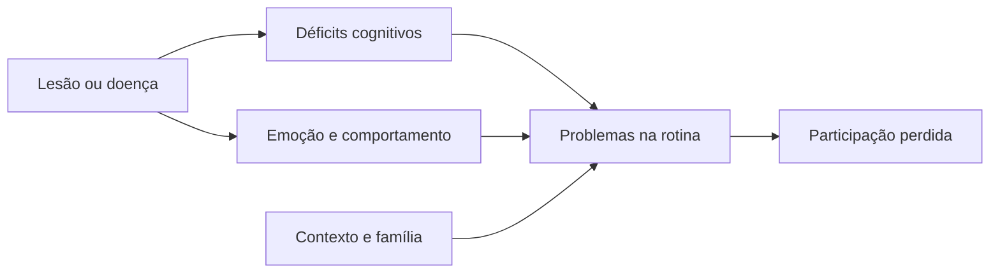

<!--
- Estrutura do encontro: 1 h de avaliação e formulação, 30 min de plano e medidas, 30 min de intervalo, 30 min de equipe e ética, 30 min de plano em grupo a partir da vinheta.
- Esta aula entrega o modelo de plano que os grupos usam no trabalho do filme *Meu Pai* (S17).
-->

---
layout: agenda
kicker: Aula 16 · o caminho de hoje
title: Caminho da aula
items:
  - {
      topic: "Avaliar para reabilitar",
      desc: "o que a avaliação precisa entregar"
    }
  - {
      topic: "Formulação",
      desc: "juntar as peças do caso"
    }
  - {
      topic: "O plano",
      desc: "metas, intervenções, medidas e prazos"
    }
  - {
      topic: "A equipe e a ética",
      desc: "quem faz o quê"
    }
  - {
      topic: "Do laudo ao plano",
      desc: "a vinheta"
    }
---

---
layout: section
index: "01"
kicker: Parte um
title: Avaliar para reabilitar
subtitle: O que a avaliação precisa entregar.
---

---
layout: vs
kicker: Duas avaliações
title: Diagnóstica e para reabilitação
left:
  title: "Para diagnóstico"
  items:
    - "Qual o perfil e qual o quadro?"
    - "Testes padronizados e normas"
    - "Termina na hipótese"
right:
  title: "Para reabilitação"
  items:
    - "O que a pessoa precisa e quer fazer?"
    - "Testes, rotina, ambiente e família"
    - "Termina nas metas"
---

<!--
- A avaliação para reabilitação acrescenta o que o teste não mede: o dia a dia, as forças, as preferências, a rede de apoio.
- Wilson (2008): avalia-se o que se vai tratar. Um escore de memória não diz se a pessoa esquece o remédio ou o fogão.
-->

---
layout: columns
kicker: O que levantar
title: Além dos testes
columns:
  - {
      title: "A pessoa",
      items: [
        "Rotina de antes e de agora",
        "Valores, interesses, metas",
        "Consciência do déficit"
      ]
    }
  - {
      title: "O contexto",
      items: [
        "Casa, trabalho e bairro",
        "Cuidadores e sobrecarga",
        "Recursos e renda"
      ]
    }
  - {
      title: "As forças",
      items: [
        "Funções preservadas",
        "Hábitos antigos que ajudam",
        "O que motiva"
      ]
    }
---

<!--
- Instrumentos: escalas de atividades de vida diária (Pfeffer, Lawton), observação em situação real, diário de falhas preenchido pela família, entrevista sobre metas.
- As forças são o que se usa para compensar: alguém com memória de procedimento preservada aprende rotina; alguém que gosta de música aprende com música.
-->

---
layout: section
index: "02"
kicker: Parte dois
title: Formulação
subtitle: Juntar as peças do caso.
---

---
layout: diagram
kicker: O raciocínio do caso
title: Da lesão à participação
---

<!--
- A formulação explica por que a pessoa tem aquele problema naquela rotina. É a hipótese de trabalho do plano — e muda quando o plano não funciona.
- Exemplo: "esquece o remédio" pode vir da memória (não lembra), da executiva (não planeja), do humor (não se importa) ou do contexto (ninguém compra). Cada causa pede uma intervenção diferente.
-->

---
layout: default
kicker: Fixação · pergunta 1
title: Ele não toma o remédio
---

Sr. Antônio, 70 anos, AVC há um ano. A esposa diz que ele "esquece o remédio". Na
avaliação, a memória está preservada; há apatia importante e ele diz que "não vê sentido em
tomar". Qual a formulação mais coerente?

<v-clicks>

- **A.** Déficit de memória prospectiva, a tratar com alarme
- **B.** Falha motivacional ligada a apatia ou depressão, que pede investigação do humor
- **C.** Recusa voluntária, que não é tema da reabilitação
- **D.** Déficit de planejamento, a tratar com GMT

</v-clicks>

---
layout: default
kicker: Fixação · resposta 1
title: A resposta é B
---

<Grid head highlight="row:3" :data="[
  ['', 'Alternativa', 'Por que erra — ou por que acerta'],
  ['A', 'Memória prospectiva', 'a memória está preservada; o alarme não resolve a falta de sentido'],
  ['B', 'Apatia ou depressão', '<b>correta</b> — a causa é motivacional; a intervenção começa pelo humor'],
  ['C', 'Recusa voluntária', 'apatia e depressão pós-AVC são parte do quadro e se tratam'],
  ['D', 'Planejamento', 'nada indica falha executiva nessa tarefa simples'],
]" />

---
layout: section
index: "03"
kicker: Parte três
title: O plano
subtitle: Metas, intervenções, medidas e prazos.
---

---
layout: steps
kicker: O modelo do semestre
title: As partes de um plano de reabilitação
steps:
  - {
      icon: "lucide:id-card",
      title: "Identificação e história",
      desc: "quem é, o que aconteceu, quem cuida"
    }
  - {
      icon: "lucide:clipboard-list",
      title: "Síntese da avaliação",
      desc: "forças, déficits e impacto na rotina"
    }
  - {
      icon: "lucide:workflow",
      title: "Formulação",
      desc: "por que os problemas acontecem"
    }
  - {
      icon: "lucide:target",
      title: "Metas SMART",
      desc: "de curto e médio prazo, com escala GAS"
    }
  - {
      icon: "lucide:wrench",
      title: "Intervenções",
      desc: "técnica, responsável, frequência e local"
    }
  - {
      icon: "lucide:ruler",
      title: "Medidas e reavaliação",
      desc: "como saber se funcionou, e quando"
    }
---

<!--
- É exatamente a estrutura pedida no trabalho do filme. O modelo em tabela está em `referencias/atividades/referencia-estudo-de-caso-meu-pai.docx`.
-->

---
layout: default
kicker: Uma linha do plano
title: Meta, técnica, quem e como medir
---

<Grid head :data="[
  ['Meta', 'Técnica', 'Quem', 'Frequência', 'Medida'],
  ['Tomar os 3 remédios sem lembrete em 6 de 7 dias, em 8 semanas', 'caixa com alarme; aprendizagem sem erro do uso', 'neuropsicólogo treina; filha acompanha', 'sessão semanal; uso diário', 'registro de doses; GAS'],
  ['Preparar o café da manhã sozinho, em 6 semanas', 'GMT; checklist na geladeira', 'neuropsicólogo e TO', '2 vezes por semana', 'observação; GAS'],
]" />

<!--
- Cada meta tem a sua linha. O plano típico tem de 3 a 5 metas por ciclo; mais do que isso dispersa a família e a equipe.
-->

---
layout: compare
kicker: Medidas de resultado
title: Medir em três níveis
columns: ["Nível", "Exemplo de medida", "Quando", "Para quê"]
rows:
  - { metric: "Meta individual", before: "GAS", after: "a cada ciclo", delta: "a meta foi alcançada?" }
  - { metric: "Funcionalidade", before: "escalas de AVD, diário de falhas", after: "início e fim", delta: "a rotina mudou?" }
  - { metric: "Cognição e humor", before: "testes e escalas", after: "reavaliação", delta: "o quadro mudou?" }
---

<!--
- A reavaliação neuropsicológica com testes costuma ser feita a cada 6 a 12 meses, com formas paralelas quando houver. O plano, porém, se revisa a cada ciclo de metas.
-->

---
layout: section
index: "04"
kicker: Parte quatro
title: A equipe e a ética
subtitle: Quem faz o quê.
---

---
layout: default
kicker: A equipe
title: Quem faz o quê
---

<Grid head :data="[
  ['Profissional', 'Foco principal', 'Na reabilitação'],
  ['Neuropsicologia', 'cognição, emoção, comportamento', 'estratégias, consciência, família'],
  ['Fonoaudiologia', 'linguagem, fala, deglutição', 'afasia e comunicação'],
  ['Terapia ocupacional', 'atividades de vida diária', 'rotina, casa, adaptações'],
  ['Fisioterapia', 'movimento e equilíbrio', 'marcha e prevenção de quedas'],
  ['Medicina', 'doença e medicação', 'neurologia, psiquiatria, geriatria'],
]" />

<!--
- Multidisciplinar: cada um faz a sua parte. Interdisciplinar: as metas são comuns e cada profissional contribui para elas. Transdisciplinar: as fronteiras se borram e um profissional executa técnicas de outro, com supervisão.
- Serviço social e enfermagem entram em quase todos os casos graves.
-->

---
layout: panels
kicker: Ética na reabilitação
title: Quatro cuidados
panels:
  - {
      icon: "lucide:hand-heart",
      title: "Autonomia",
      body: "A meta é da pessoa, mesmo quando a família quer outra."
    }
  - {
      icon: "lucide:scale",
      title: "Capacidade",
      body: "Decisões são apoiadas, não tomadas pela pessoa."
    }
  - {
      icon: "lucide:lock",
      title: "Sigilo na equipe",
      body: "Compartilhar o necessário para o cuidado."
    }
  - {
      icon: "lucide:badge-check",
      title: "Evidência",
      body: "Não prometer recuperação que a técnica não oferece."
    }
---

<!--
- Conflito clássico: a família quer que o pai pare de dirigir; ele quer continuar. O neuropsicólogo informa o risco com dados, apoia a decisão e envolve a equipe médica — não decide sozinho nem esconde o dado.
- No Brasil, a Lei Brasileira de Inclusão (13.146/2015) prevê a tomada de decisão apoiada.
-->

---
layout: section
index: "05"
kicker: Parte cinco
title: Do laudo ao plano
subtitle: A vinheta.
---

---
layout: default
kicker: Vinheta clínica
aside: "vinheta clínica"
title: Sr. Rodrigo, oito meses depois
---

O motoboy da aula 05 foi afastado da moto. Mora com a companheira e quer voltar a
trabalhar. A companheira está exausta com as explosões de irritação.

<Callout icon="lucide:message-square">A tarefa: <strong>do laudo da aula 05, montem o plano de reabilitação.</strong></Callout>

<!--
- Ficha: `referencias/aula-16/vinheta-sr-rodrigo-plano.docx`, com o laudo resumido e as metas que ele e a companheira trazem.
- O que os grupos precisam notar: metas dele (voltar a trabalhar) e dela (menos brigas) são legítimas e diferentes; consciência reduzida pede treino de autoconsciência antes de qualquer meta laboral; irritabilidade pede análise funcional e trabalho com a companheira; equipe com TO para reabilitação profissional.
-->

---
layout: statement
kicker: Dinâmica em grupo
title: Três metas SMART, uma técnica para cada e <em>como medir</em>.
---

<!--
- Use a tabela do slide "Meta, técnica, quem e como medir". 25 min de escrita e 15 de leitura.
- É o ensaio do trabalho do filme: mesma estrutura, outro caso.
-->

---
layout: panels
kicker: Para levar
title: Três coisas que ficam
panels:
  - {
      icon: "lucide:search",
      title: "Avaliar o que se trata",
      body: "Rotina, contexto e forças, além do escore."
    }
  - {
      icon: "lucide:workflow",
      title: "Formular antes de intervir",
      body: "O mesmo problema tem <strong>causas diferentes</strong> e pede técnicas
        diferentes."
    }
  - {
      icon: "lucide:users",
      title: "O plano é da equipe",
      body: "Metas comuns, cada profissional na sua parte, com a pessoa no centro."
    }
---

---
layout: reference
kicker: Referências
title: Base desta aula
items:
  - {
      term: "Wilson, 2008",
      desc: "Neuropsychological rehabilitation. <em>Annual Review of Clinical
        Psychology</em>, 4, 141-162."
    }
  - {
      term: "Wilson et al., 2017",
      desc: "<em>Neuropsychological rehabilitation: the international handbook</em>.
        London: Routledge."
    }
  - {
      term: "Turner-Stokes, 2009",
      desc: "Goal attainment scaling (GAS) in rehabilitation: a practical guide.
        <em>Clinical Rehabilitation</em>, 23(4), 362-370."
    }
  - {
      term: "Abrisqueta-Gomez, 2012",
      desc: "<em>Reabilitação neuropsicológica: abordagem interdisciplinar e modelos
        conceituais na prática clínica</em>. Porto Alegre: Artmed."
    }
  - {
      term: "Brasil, 2015",
      desc: "Lei n. 13.146, de 6 de julho de 2015. Lei Brasileira de Inclusão da
        Pessoa com Deficiência."
    }
---
